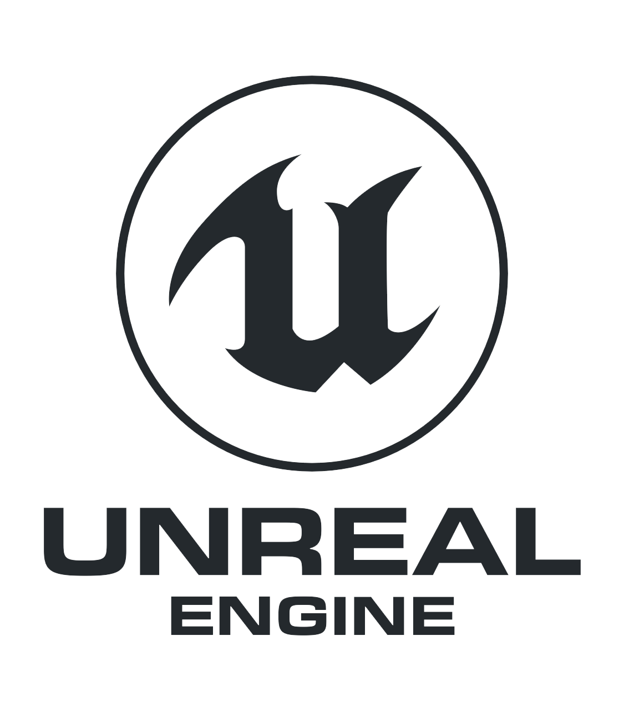
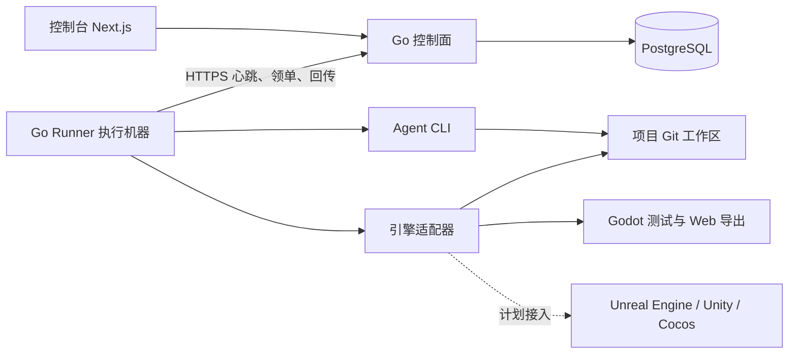

# Agentrib

Agentrib 的目标是让人类与 AI 智能体**像一个真正的游戏工作室一样协同工作**：人类主导创意与关键决策，AI 智能体承担研发、测试与交付。目前聚焦产研——研发工作流已经落地并在真实项目上运行；运营与发行工作流正在设计中。

[项目官网](https://www.agentrib.com/) · [控制台](https://www.agentrib.com/console/) · [部署与验收说明](docs/deployment.md)

## 工作室业务线

| 业务线 | 状态 | 说明 |
| --- | --- | --- |
| 研发 | 当前聚焦 | 工作流编辑、Agent 派单、引擎测试、QA 门禁与交付通知已上线 |
| 运营 | 设计中 | 复用同一套协调机制 |
| 发行 | 设计中 | 复用同一套协调机制 |

## 研发工作流

在控制台设计工作流，为每个步骤选择引擎、指派 Agent 并设置步骤依赖。派单后由已接入的执行机器接单执行，后续步骤接续上游的 Git 提交。一次制作的典型流转：

| 步骤 | 内容 | Git 流转 |
| --- | --- | --- |
| 简报 | 确认需求与分工 | 从项目当前 HEAD 开始 |
| 美术 / 开发 | 场景资源 / 玩法逻辑 | 接续上游提交 |
| CI 测试 | 引擎测试 + 导出 | 接续合并提交 |
| QA 验收 | 核对提交与产物 | 同一提交 |
| 交付 | 审批后发布 | 试玩包与验收报告 |

每个步骤在独立的 Git worktree 中运行，产出以提交保存在项目本机的 `refs/agentrib/runs/`；QA 与构建核对同一提交，确保验收的就是将要交付的版本。关键节点由人类审批确认，执行中断后可从失败处继续。

开发步骤可选「提交给 CI 前检查编译与启动」；CI 失败可指派修复 Agent；QA 失败按缺陷单退回对应角色返工，通过后才通知交付。还可以与产品 Agent 讨论需求并生成简报，一键填入工作流。

## 游戏引擎支持

在「工作流编辑 → 游戏引擎」中选择引擎并保存版本。计划接入的引擎可以先配置工作流，适配器上线后即可派单。

| 引擎 | 接入状态 | 项目结构与开发流程 |
| --- | --- | --- |
|  **Godot 4** | **已接入** | `project.godot`。Mac mini 已验证无界面测试和 Web 试玩包导出。 |
| <picture><source media="(prefers-color-scheme: dark)" srcset="site/engines/unreal-white.png"></picture> **Unreal Engine** | 计划接入 | `.uproject` 与 `Source/`。面向 C++ 与蓝图工作流。 |
| <picture><source media="(prefers-color-scheme: dark)" srcset="site/engines/unity-white.svg"></picture> **Unity** | 计划接入 | `Assets/` 与 `Packages/`。面向 C# 工作流。 |
|  **Cocos Creator** | 计划接入 | `assets/` 与 `package.json`。面向 TypeScript 工作流。 |

## Agent CLI

在 Runner 机器上安装并配置所需的 CLI。在控制台的「工作流编辑 → 执行方式」中逐步选择 Agent。新增「编写产品文档」步骤时，可以指定把结果写入 `docs/product.md`，并将该步骤设为后续开发的提交来源。支持只读工具限制的适配器提供「只读验收」，可担任 QA 步骤。

| Agent | CLI | Agent | CLI |
| --- | --- | --- | --- |
| Claude Code | `claude` | OpenAI Codex | `codex` |
| OpenCode | `opencode` | OpenClaw | `openclaw` |
| Hermes | `hermes` | Pi | `pi` |
| Antigravity | `agy` | CodeBuddy | `codebuddy` |
| Grok | `grok` | Kimi | `kimi` |
| Qoder CLI | `qodercli` | Qoder CN | `qoderclicn` |
| DeepSeek Harness | `dsh` | Oh-My-Pi | `omp` |
| MiniMax Code | `mcode` | ZCode | `zcode` |

## 项目架构

- **控制台**　Next.js Web 控制台，分「制作工作台」与「运行记录」：查看执行机器能力与 Agent 额度、创建游戏项目、编辑工作流版本、与产品 Agent 讨论生成简报、发起制作；在运行记录中查看步骤时间线、执行日志、QA 缺陷单与修复记录，下载试玩包。
- **控制面**　Go 控制面 + PostgreSQL：保存工作流版本与运行记录，按步骤依赖派单；租约调度、心跳监测、断线重试，并对产物做 SHA-256 校验。
- **执行机器**　Go Runner（当前部署在 Mac mini）：HTTPS 轮询领单，在独立 Git worktree 中调用 Agent CLI 与游戏引擎，回传提交、日志与构建产物；本地未提交的改动始终保留。

## 实现步骤

每完成一项并通过该项检查，就独立提交到本仓库。以下步骤均已通过对应检查。

| 步骤 | 要实现的内容 | 通过条件 |
| --- | --- | --- |
| 1. 项目说明与官网 | 更新 Agent 和引擎支持说明 | 公开页面准确说明支持范围和进度 |
| 2. 控制面 | Go API、PostgreSQL、机器注册、任务领取和事件记录 | 数据库重启后状态可恢复，重复领单和回传保持一致 |
| 3. Mac Runner | HTTP 轮询、CLI 适配、Git 工作区、Godot 命令 | 真机运行界面生成、开发和只读 QA，任务可取消，日志可追溯 |
| 4. 工作流编辑 | 可编辑步骤和依赖，策划、制作人、开发、QA 角色绑定 | 在控制台创建工作流、派单、查看结果和人工确认 |
| 5. Godot 交付 | 关联 Git 提交、Godot 测试报告和 Web 导出包 | 测试、QA 与导出包对应同一 Git 提交 |
| 6. 部署与验收 | 云端部署控制台、API 和数据库，Mac mini 部署 Runner | 跨机器验证真实 Agent、Godot、取消、断线恢复及交付链路 |
| 7. 产研工作流闭环 | QA 门禁、CI 失败修复派单、缺陷返工与交付通知 | 运行记录可追溯缺陷单与修复记录，验收与交付对应同一提交 |
| 8. 产品简报与工作室定位 | 产品 Agent 讨论生成简报；官网与 README 说明工作室业务线 | 简报可一键填入工作流；公开页面准确描述研发、运营与发行 |

## 设计参考

[Multica](https://github.com/multica-ai/multica) 的控制面、Runner 和 Agent 适配模式，以及 [Claude Code Game Studios](https://github.com/Donchitos/Claude-Code-Game-Studios) 的角色、关卡简报、Godot 测试与交接流程。
