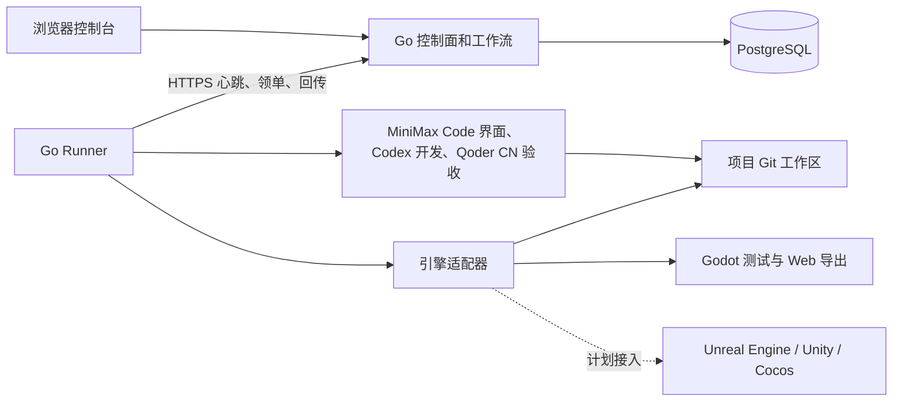

# Agentrib

Agentrib 是一个面向**游戏开发**的 Agent 协作工具。在浏览器里为工作流选择游戏引擎。MiniMax Code 生成界面，Codex 接过界面提交实现玩法，Runner 调用所选引擎测试和构建，Qoder CN 对交付版本做只读 QA。

[项目官网](https://www.agentrib.com/) · [浏览器控制台](https://www.agentrib.com/console/)

[部署与验收说明](docs/deployment.md)

Godot 已在 Mac mini 上通过真机验收。Unreal Engine、Unity 和 Cocos 已列入引擎选择，可保存工作流版本，接入各自的 Runner 适配器后即可运行。

## 首版范围

- **入口**　浏览器控制台，可编辑工作流、绑定 Agent、派单、查看日志和确认交付。
- **执行**　Go Runner 通过 HTTPS 向 Go 控制面上报本机项目和引擎能力。控制面将引擎选择随工作流版本保存在 PostgreSQL，Runner 在独立 Git 工作区调用对应适配器。
- **验收项目**　《月面送电》，一款 10 关的 2D 休闲推箱解谜游戏。10 关的解法须在 Godot 中逐关重放，试玩包与验收记录须对应同一个 Git 提交。

## 实现步骤

每完成一项并通过该项检查，就独立提交到本仓库。

| 步骤 | 要实现的内容 | 通过条件 |
| --- | --- | --- |
| 1. 项目说明与官网 | 明确 Godot 专用定位、更新 README 和官网 | 公开页面准确说明首版范围和进度 |
| 2. 控制面 | Go API、PostgreSQL、机器注册、任务领取和事件记录 | 数据库重启后状态可恢复，重复领单和回传保持一致 |
| 3. Mac Runner | HTTP 轮询、CLI 适配、Git 工作区、Godot 命令 | 真机运行界面生成、开发和只读 QA，任务可取消，日志可追溯 |
| 4. 网页工作流 | 可编辑步骤和依赖，策划、制作人、开发、QA 角色绑定 | 从浏览器完成建流程、派单、查看结果和人工确认 |
| 5. Godot 交付 | 关联 Git 提交、Godot 测试报告和 Web 导出包 | 测试、QA 与导出包对应同一 Git 提交 |
| 6. 部署与验收 | 云端部署控制台、API 和数据库，Mac mini 部署 Runner | 跨机器验证真实 Agent、Godot、取消、断线恢复及交付链路 |

## 设计参考

[Multica](https://github.com/multica-ai/multica) 的控制面、Runner 和 Agent 适配模式，以及 [Claude Code Game Studios](https://github.com/Donchitos/Claude-Code-Game-Studios) 的角色、关卡简报、Godot 测试与交接流程。
