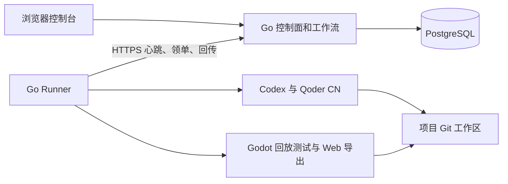

# Agentrib

Agentrib 是一个面向 **Godot 游戏开发**的 Agent 协作工具。在浏览器里编排策划、开发、测试和交付步骤，由执行机器上的 Runner 调用 Codex、Qoder CN 等本机 Agent。

[项目官网](https://www.agentrib.com/)

## 首版范围

- **入口**　浏览器控制台，可编辑工作流、绑定 Agent、派单、查看日志和确认交付。
- **执行**　Go Runner 主动通过 HTTPS 连接 Go 控制面，使用本机 Git 工作区和 Godot 命令行。控制面用 PostgreSQL 持久化任务、运行记录和产物。
- **验收项目**　《月面送电》，一款 10 关的 2D 休闲推箱解谜游戏。10 关的解法须在 Godot 中逐关重放，试玩包与验收记录须对应同一个 Git 提交。

## 实现步骤

每完成一项并通过该项检查，就独立提交到本仓库。

| 步骤 | 要实现的内容 | 通过条件 |
| --- | --- | --- |
| 1. 项目说明与官网 | 明确 Godot 专用定位、更新 README 和官网 | 公开页面准确说明首版范围和进度 |
| 2. 控制面 | Go API、PostgreSQL、机器注册、任务领取和事件记录 | 数据库重启后状态可恢复，重复领单和回传保持一致 |
| 3. Mac Runner | HTTP 轮询、CLI 适配、Git 工作区、Godot 命令 | 真机探测并运行 Codex、Qoder CN，任务可取消，日志可追溯 |
| 4. 网页工作流 | 可编辑步骤和依赖，策划、制作人、开发、QA 角色绑定 | 从浏览器完成建流程、派单、查看结果和人工确认 |
| 5. Godot 交付 | 关联 Git 提交、Godot 测试报告和 Web 导出包 | 验收版本与发布版本一致，10 关具有可重放记录 |
| 6. 部署与验收 | 云端部署控制台、API 和数据库，Mac mini 部署 Runner | 跨机器验证真实 Agent、Godot、取消、断线恢复及交付链路 |

## 设计参考

[Multica](https://github.com/multica-ai/multica) 的控制面、Runner 和 Agent 适配模式，以及 [Claude Code Game Studios](https://github.com/Donchitos/Claude-Code-Game-Studios) 的角色、关卡简报、Godot 测试与交接流程。
