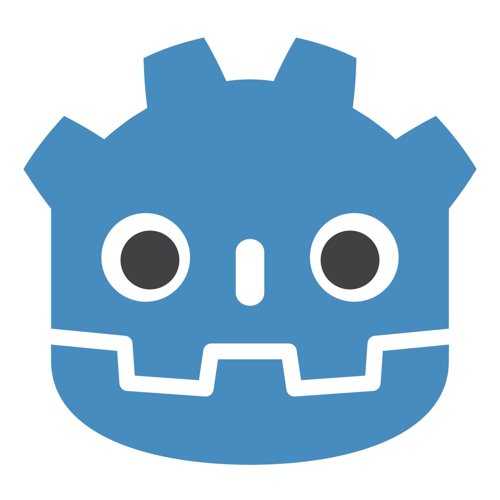
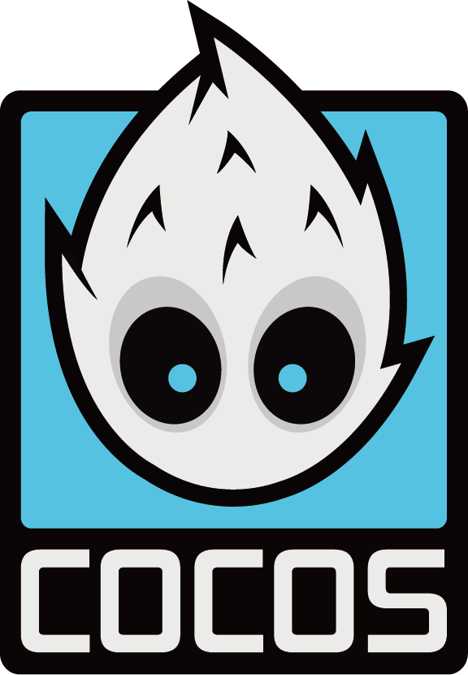
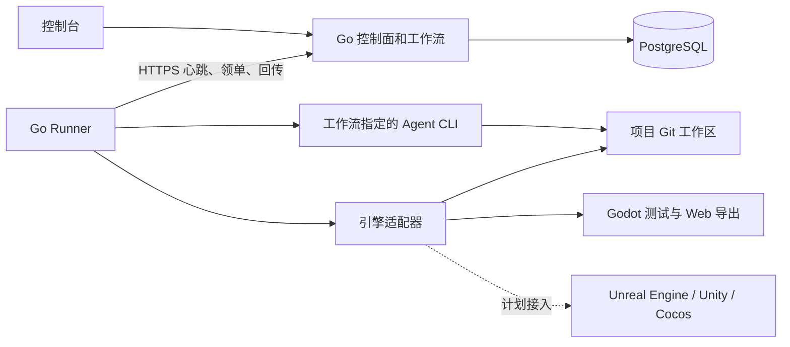

# Agentrib

Agentrib 是一个面向**游戏开发**的 Agent 协作工具。在控制台设计工作流，在流程中选择引擎、指派 Agent 并设置步骤依赖。Agentrib 把任务派到已接入的执行机器，后续步骤可以接续上游的 Git 提交。

[项目官网](https://www.agentrib.com/)

[部署与验收说明](docs/deployment.md)

## 游戏引擎支持

在「工作流编辑 → 游戏引擎」中选择引擎并保存版本。计划接入的引擎可以先配置工作流，适配器上线后即可派单。

| 引擎 | 接入状态 | 项目结构与开发流程 |
| --- | --- | --- |
|  **Godot 4** | **已接入** | `project.godot`。Mac mini 已验证无界面测试和 Web 试玩包导出。 |
| <picture><source media="(prefers-color-scheme: dark)" srcset="site/engines/unreal-white.png"></picture> **Unreal Engine** | 计划接入 | `.uproject` 与 `Source/`。面向 C++ 与蓝图工作流。 |
| <picture><source media="(prefers-color-scheme: dark)" srcset="site/engines/unity-white.svg"></picture> **Unity** | 计划接入 | `Assets/` 与 `Packages/`。面向 C# 工作流。 |
|  **Cocos Creator** | 计划接入 | `assets/` 与 `package.json`。面向 TypeScript 工作流。 |

## Agent CLI

在 Runner 机器上安装并配置所需的 CLI。在控制台的「工作流编辑 → 执行方式」中逐步选择 Agent。新增「编写产品文档」步骤时，可以指定把结果写入 `docs/product.md`，并将该步骤设为后续开发的提交来源。

| Agent | CLI | Agent | CLI |
| --- | --- | --- | --- |
| Claude Code | `claude` | OpenAI Codex | `codex` |
| OpenCode | `opencode` | OpenClaw | `openclaw` |
| Hermes | `hermes` | Pi | `pi` |
| Antigravity | `agy` | CodeBuddy | `codebuddy` |
| Grok | `grok` | Kimi | `kimi` |
| Qoder CLI | `qodercli` | Qoder CN | `qoderclicn` |
| DeepSeek Harness | `dsh` | Oh-My-Pi | `omp` |
| MiniMax Code | `mcode` | ZCode | `zcode` |

## 项目架构

- **入口**　控制台可编辑工作流、绑定 Agent、派单、查看日志和确认交付。目前提供 Web 版，计划推出客户端。
- **执行**　Go Runner 通过 HTTPS 向 Go 控制面上报本机项目和引擎能力。控制面将引擎选择随工作流版本保存在 PostgreSQL，Runner 在独立 Git 工作区调用对应适配器。

## 实现步骤

每完成一项并通过该项检查，就独立提交到本仓库。

| 步骤 | 要实现的内容 | 通过条件 |
| --- | --- | --- |
| 1. 项目说明与官网 | 更新 Agent 和引擎支持说明 | 公开页面准确说明支持范围和进度 |
| 2. 控制面 | Go API、PostgreSQL、机器注册、任务领取和事件记录 | 数据库重启后状态可恢复，重复领单和回传保持一致 |
| 3. Mac Runner | HTTP 轮询、CLI 适配、Git 工作区、Godot 命令 | 真机运行界面生成、开发和只读 QA，任务可取消，日志可追溯 |
| 4. 工作流编辑 | 可编辑步骤和依赖，策划、制作人、开发、QA 角色绑定 | 在控制台创建工作流、派单、查看结果和人工确认 |
| 5. Godot 交付 | 关联 Git 提交、Godot 测试报告和 Web 导出包 | 测试、QA 与导出包对应同一 Git 提交 |
| 6. 部署与验收 | 云端部署控制台、API 和数据库，Mac mini 部署 Runner | 跨机器验证真实 Agent、Godot、取消、断线恢复及交付链路 |

## 设计参考

[Multica](https://github.com/multica-ai/multica) 的控制面、Runner 和 Agent 适配模式，以及 [Claude Code Game Studios](https://github.com/Donchitos/Claude-Code-Game-Studios) 的角色、关卡简报、Godot 测试与交接流程。
