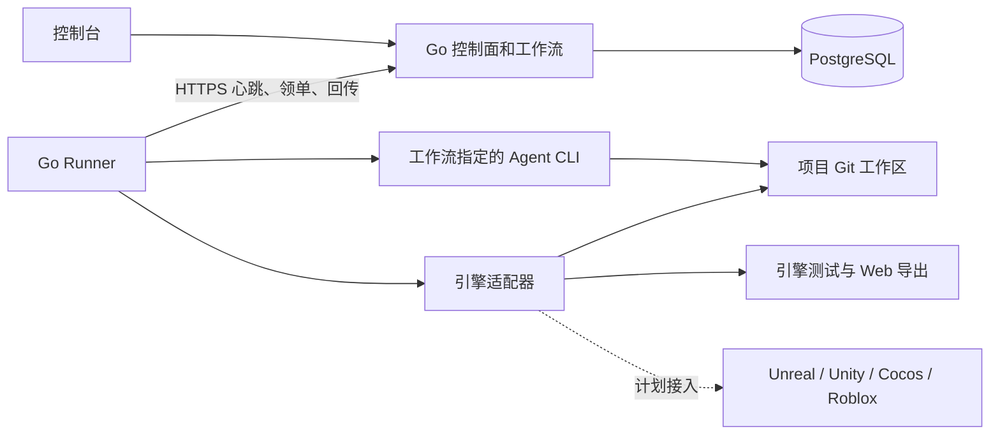

# Agentrib

Agentrib 让人类与 AI Agent 按游戏工作室的分工协作。**人类担任制作人**，负责立项、确认需求和处理关键审批。产品、美术、音效、开发和 QA Agent 按工作流接续上游的 Git 提交，把简报变成可验收的游戏构建。

[项目官网](https://www.agentrib.com/) · [部署与验收说明](docs/deployment.md)

## 工作室路线图

| 业务线 | 进度 | 工作内容 |
| --- | --- | --- |
| 研发 | **已上线，当前重点** | 从产品简报、资源制作与开发集成，到引擎测试与导出、QA 返工和交付通知。 |
| 运营 | 设计中 | 接入数据源，支持活动策划、玩家反馈、社区与客服，以及上线后的数据复盘。 |
| 发行 | 设计中 | 接入发行平台，编排宣发素材、商店上架、本地化和投放等任务。 |

运营与发行计划复用研发中的派单、产出追踪和人工审批机制。[官网的工作室规划](https://www.agentrib.com/#studio)

## 研发工作流

1. **确认简报**。制作人可以直接填写简报，也可以与产品 Agent 讨论后生成简报，再填入工作流。产品 Agent 按确认的范围写出需求、分工和验收标准。
2. **制作与集成**。美术和音效接续产品 Agent 的提交制作资源。开发合并两边的提交，接入资源并实现玩法，可在提交 CI 前先检查编译和启动。
3. **构建与试玩**。CI 对开发提交执行引擎无界面测试并导出 Web 试玩包。可为 CI 配置失败处理 Agent。QA 阶段即可下载对应构建的测试版。
4. **验收与返工**。QA 按构建对应的提交验收。归属明确的缺陷按角色派修，分工不清的缺陷进入产品分诊，到达自动返工上限后由人决定下一步。修复后重新构建并复验，缺陷编号贯穿各轮。环境类缺陷可以逐项注明理由并延期，仍保留未验证状态。
5. **交付**。QA 通过本轮验收范围后，运行记录提供交付通知、对应的试玩包和验收报告。工作流可按需配置人工确认节点。

「运行记录」中可以在线阅读产品 Markdown、查看美术图片、试听音效。各 Agent 的尝试记录展示开始时间、耗时和关键日志。执行中断时可以从失败处继续，保留已通过的步骤与产物。同一构建的有效 QA 缺陷单可用于恢复返工。

## 快速开始

1. 按[部署与验收说明](docs/deployment.md)配置 Go 控制面与 PostgreSQL，接入一台安装了 Git、项目所选的游戏引擎和所需 Agent CLI 的 Runner。
2. 在控制台选择已有游戏项目或创建新项目。从游戏模板创建工作流，为各步骤绑定 Agent 并保存版本。
3. 填写制作简报并启动工作流。在「运行记录」选择项目和本次运行，查看产出、下载测试版或处理 QA 缺陷。

**Moon power（月面送电）** 是用来验证这条研发链路的 2D 推箱解谜项目。[查看游戏作品](https://www.agentrib.com/#projects)

## 游戏引擎支持

在「工作流编辑 → 游戏引擎」中选择引擎并保存版本。计划接入的引擎可以先配置工作流，适配器上线后即可派单。

| 引擎 | 接入状态 | 项目结构与开发流程 |
| --- | --- | --- |
|  **Godot 4** | **已接入** | `project.godot`。Mac mini 已验证无界面测试和 Web 试玩包导出。 |
| <picture><source media="(prefers-color-scheme: dark)" srcset="site/engines/unreal-white.png"></picture> **Unreal Engine** | 计划接入 | `.uproject` 与 `Source/`。面向 C++ 与蓝图工作流。 |
| <picture><source media="(prefers-color-scheme: dark)" srcset="site/engines/unity-white.svg"></picture> **Unity** | 计划接入 | `Assets/` 与 `Packages/`。面向 C# 工作流。 |
|  **Cocos Creator** | 计划接入 | `assets/` 与 `package.json`。面向 TypeScript 工作流。 |
|  **Roblox Studio** | 计划接入 | Rojo `default.project.json` 与 `src/`。面向 Luau 工作流。 |

## Agent CLI

在 Runner 上安装并登录所需的 CLI，再从「工作流编辑 → 执行方式」为步骤选择 Agent。执行机器卡片会显示 CLI 状态和能查询到的额度。额度未知时，可以手动发起一次短模型请求测试可用性。

| Agent | CLI | Agent | CLI |
| --- | --- | --- | --- |
| Claude Code | `claude` | OpenAI Codex | `codex` |
| OpenCode | `opencode` | OpenClaw | `openclaw` |
| Hermes | `hermes` | Pi | `pi` |
| Antigravity | `agy` | CodeBuddy | `codebuddy` |
| Grok | `grok` | Kimi | `kimi` |
| Qoder CLI | `qodercli` / `qoder` | Qoder CN | `qoderclicn` / `qodercn` |
| DeepSeek Harness | `dsh` | Oh-My-Pi | `omp` |
| MiniMax Code | `mcode` | ZCode | `zcode` |

## 项目架构

- **控制台**使用 Next.js，提供工作流编辑、人工操作和运行记录。
- **控制面**使用 Go 和 PostgreSQL，保存工作流版本、运行状态和 QA 决策，按依赖与租约进行调度，并通过 SHA-256 校验上传产物。
- **执行机器**运行 Go Runner，通过 HTTPS 上报能力、领单和回传结果。Runner 基于已提交的版本，在独立 Git worktree 中执行步骤，把产出提交保存在项目仓库的 `refs/agentrib/runs/`。

## 设计参考

[Multica](https://github.com/multica-ai/multica) 的控制面、Runner 和 Agent 适配模式，以及 [Claude Code Game Studios](https://github.com/Donchitos/Claude-Code-Game-Studios) 的角色、关卡简报、Godot 测试与交接流程。
